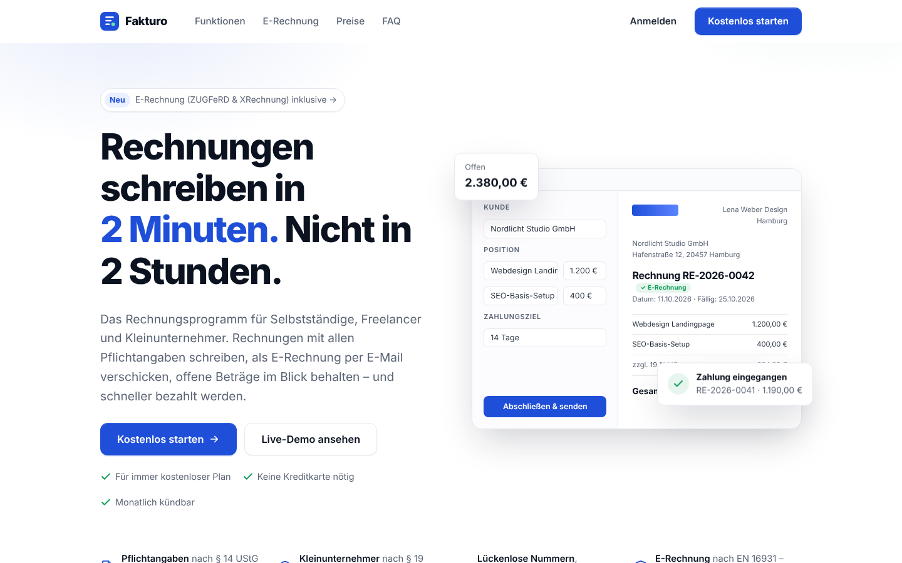

# Fakturo – Rechnungsprogramm mit monatlichem Abo

Fakturo ist eine fertige SaaS-Website: **Landingpage + Web-App + Abo-Bezahlung über Stripe**.
Zielgruppe: Selbstständige, Freelancer und Kleinunternehmer in Deutschland. Sie müssen jeden Monat
Rechnungen schreiben – und ab 2027/2028 als **E-Rechnung**. Das ist ein wiederkehrendes Problem
mit gesetzlichem Druck, also genau das, wofür Menschen ein Abo bezahlen.



## Schnellstart (Windows, macOS, Linux)

Voraussetzung: [Node.js](https://nodejs.org) in Version **22.5 oder neuer** (LTS-Version installieren).

```
git clone https://github.com/GamerNik0908/NeuNeu.git
cd NeuNeu
git checkout claude/website-monthly-subscriptions-ivuih2
npm install
npm start
```

Dann im Browser **http://localhost:3000** öffnen. Zum Beenden im Terminal `Strg + C`.

Ohne weitere Einrichtung läuft Fakturo im **Testbetrieb**: Upgrades werden ohne Zahlung freigeschaltet
und Rechnungen versendet man über das eigene E-Mail-Programm. Auf der Startseite kannst du über
**„Live-Demo ansehen“** sofort ein Konto mit Beispieldaten ausprobieren.

```
npm test        # automatisierte Tests (API, Rechenlogik, E-Rechnung, Sicherheit)
```

## Warum dieses Produkt verkauft

| Frage | Antwort |
| --- | --- |
| Wer zahlt? | Millionen Selbstständige in Deutschland müssen Rechnungen mit Pflichtangaben (§ 14 UStG) schreiben. |
| Warum jetzt? | E-Rechnungspflicht: Empfang seit 2025, Versand ab 2027 (über 800.000 € Umsatz) bzw. 2028 (alle). Word-Vorlagen reichen dann nicht mehr. |
| Warum monatlich? | Rechnungen fallen jeden Monat an – der Nutzen wiederholt sich, also bleibt das Abo. |
| Warum upgraden? | Der kostenlose Plan erlaubt 3 abgeschlossene Rechnungen pro Monat. Wer regelmäßig arbeitet, stößt daran – und bekommt genau in dem Moment ein Upgrade-Angebot (der Entwurf bleibt gespeichert). |
| Warum vertrauen? | Live-Demo ohne Anmeldung, kostenloser Start ohne Kreditkarte, 14 Tage Testphase, monatlich kündbar, keine Tracker. |

## Pläne

| | Starter | Pro | Business |
| --- | --- | --- | --- |
| Preis | 0 € | 9 €/Monat (84 €/Jahr) | 19 €/Monat (180 €/Jahr) |
| Abgeschlossene Rechnungen | 3 pro Monat | unbegrenzt | unbegrenzt |
| Kunden | 5 | unbegrenzt | unbegrenzt |
| E-Rechnung (ZUGFeRD & XRechnung), E-Mail-Versand, Storno | ✓ | ✓ | ✓ |
| Angebote → Rechnung | – | ✓ | ✓ |
| Eigenes Logo, ohne „Erstellt mit Fakturo“ | – | ✓ | ✓ |
| Zahlungserinnerungen & Mahnungen | – | ✓ | ✓ |
| CSV-Export für die Steuer | – | ✓ | ✓ |
| Wiederkehrende Rechnungen | – | – | ✓ |

Preise und Limits stehen in `server/plans.js` (die Texte der Landingpage in `public/index.html`).

## Funktionen

**Rechnungen nach deutschem Recht**
- Alle Pflichtangaben nach § 14 UStG. Eine Rechnung lässt sich erst abschließen, wenn sie vollständig ist –
  Fakturo sagt genau, was fehlt.
- **Lückenlose Nummern:** Entwürfe haben noch keine Nummer, sie wird erst beim Abschließen vergeben.
  Gelöschte Entwürfe hinterlassen daher keine Lücken.
- **Unveränderbar nach Abschluss.** Absender- und Kundendaten werden eingefroren – spätere Änderungen
  am Profil verändern alte Rechnungen nicht.
- **Echte Stornorechnungen** mit eigener Nummer statt „Status: storniert“.
- **Steuerfälle:** Regelbesteuerung (19 %/7 %/0 %, gemischt), Kleinunternehmer (§ 19 UStG),
  Reverse-Charge für EU-Firmenkunden, nicht steuerbare Leistungen in Drittländer – inkl. Pflichthinweisen.
  Fakturo schlägt den passenden Fall anhand des Kundenlands automatisch vor.
- Kaufmännische Rundung, Steuer je Steuersatz auf die Summe (wie EN 16931 es verlangt).

**E-Rechnung**
- Jedes PDF einer abgeschlossenen Rechnung ist ein **ZUGFeRD/Factur-X-PDF (PDF/A-3, Profil EN 16931)**.
- **XRechnung 3.0** (UN/CEFACT CII) als XML-Download oder E-Mail-Anhang, inkl. Leitweg-ID.
- Beim Entwickeln mit dem Mustang-Validator (KoSIT-Regeln, veraPDF) geprüft: gültig für alle vier Steuerfälle
  und Stornorechnungen. Siehe „E-Rechnungen selbst prüfen“ unten.

**Arbeitsablauf**
- Editor mit Live-Vorschau, Vorschlägen aus früheren Positionen, Warnung bei ungespeicherten Änderungen (Strg+S speichert).
- „Abschließen & senden“: Versand per E-Mail mit PDF (und optional XRechnung) im Anhang, Antworten gehen an den Nutzer.
- Zahlungserinnerung, 1. und 2. Mahnung mit fertigen Texten.
- Verlauf je Rechnung (erstellt, abgeschlossen, versendet, bezahlt, erinnert, storniert).
- Dashboard: offen, überfällig, bezahlt, Ø Zahlungsdauer, Umsatz der letzten 12 Monate, Top-Kunden.
- Kunden mit Kundennummern, Länderauswahl, USt-IdNr.; IBAN-Prüfung gegen Tippfehler.
- Angebote → Rechnung, Duplizieren, wiederkehrende Rechnungen, CSV-Export (Excel-kompatibel).

**Konto & Abo**
- Registrierung, Login, **Passwort vergessen**, Live-Demo-Konten (werden nach 24 Std. gelöscht).
- Stripe Checkout mit Testphase, Kundenportal (Kündigen, Zahlungsart, Belege), Webhooks.
- Beim Löschen des Kontos wird ein laufendes Abo sofort beendet.

**Technik & Sicherheit**
- Node.js + Express + SQLite (eingebaut in Node), keine schweren Abhängigkeiten.
- Passwörter mit scrypt, Sitzungen nur als Hash gespeichert, Rate-Limits, CSRF-Schutz, strenge Content-Security-Policy.
- **Keine externen Anfragen** (Schrift lokal, kein Google Fonts, keine Tracker) – kein Cookie-Banner nötig.
- Automatische Datenbank-Migrationen und tägliche Backups (`data/backups/`, 14 Tage).

## E-Mail-Versand einrichten (empfohlen)

Ohne SMTP laden Nutzer das PDF herunter und versenden es selbst. Mit SMTP geht es mit einem Klick:

1. Konto bei einem E-Mail-Dienst anlegen (z. B. [Brevo](https://www.brevo.com), Postmark, Mailjet) oder die SMTP-Daten deines Webhosters nutzen.
2. Deine Absender-Domain dort verifizieren (SPF/DKIM-Einträge setzen – sonst landen Mails im Spam).
3. In der `.env` eintragen: `SMTP_HOST`, `SMTP_PORT`, `SMTP_USER`, `SMTP_PASS`, `MAIL_FROM` (siehe `.env.example`).

Rechnungen gehen dann als „Name des Nutzers via Fakturo“ raus; Antworten landen beim Nutzer (Reply-To).

## Echte Abos mit Stripe einrichten

1. Konto auf [stripe.com](https://stripe.com) anlegen (erst im **Testmodus** arbeiten).
2. Unter **Produktkatalog** zwei Produkte anlegen: „Fakturo Pro“ und „Fakturo Business“,
   jeweils mit zwei wiederkehrenden Preisen (monatlich 9 € / jährlich 84 € bzw. 19 € / 180 €).
3. `.env.example` nach `.env` kopieren und eintragen: `STRIPE_SECRET_KEY`, die vier `STRIPE_PRICE_…`-IDs, `APP_URL`.
4. **Webhook** anlegen (Entwickler → Webhooks) mit der URL `https://DEINE-DOMAIN/api/stripe/webhook`
   und den Ereignissen `checkout.session.completed`, `customer.subscription.created`,
   `customer.subscription.updated`, `customer.subscription.deleted`. Das Signing-Secret als `STRIPE_WEBHOOK_SECRET` eintragen.
   Lokal testen: `stripe listen --forward-to localhost:3000/api/stripe/webhook`.
5. **Kundenportal** aktivieren (Einstellungen → Billing → Kundenportal): Kündigen, Planwechsel und Zahlungsart erlauben.
6. Empfohlen: **automatische Rechnungen** und **Stripe Tax** aktivieren.
7. Testkauf mit Karte `4242 4242 4242 4242` – danach auf Live-Schlüssel umstellen.

## Online stellen

Ein einzelner Node-Prozess mit SQLite – läuft z. B. auf einem kleinen VPS (Hetzner, ~5 €/Monat), Render, Railway oder Fly.io.

- `NODE_ENV=production` setzen und HTTPS verwenden (z. B. Caddy oder nginx davor).
- Den Ordner `data/` auf dauerhaftem Speicher ablegen und die Backups zusätzlich extern sichern.
- Health-Check: `GET /healthz`.

## E-Rechnungen selbst prüfen

Mit dem kostenlosen [Mustang-Validator](https://www.mustangproject.org) (Java):

```
java -jar Mustang-CLI.jar --action validate --source Rechnung_RE-2026-0001.pdf
java -jar Mustang-CLI.jar --action validate --source Rechnung_RE-2026-0001_XRechnung.xml
```

Alternativ das Prüfportal der KoSIT bzw. Online-Validatoren. Prüfe das vor dem Livegang einmal mit deinen echten Firmendaten.

## Vor dem Livegang (Pflicht in Deutschland)

- [ ] **Impressum, Datenschutzerklärung und AGB** in `public/legal/` mit echten Angaben füllen und rechtlich prüfen lassen
      (inkl. Auftragsverarbeitungsvertrag, da Nutzer Kundendaten speichern).
- [ ] Gewerbe anmelden; die Abo-Einnahmen sind steuerpflichtig.
- [ ] Eigene Domain, Support-E-Mail-Adresse, SMTP-Versand mit verifizierter Domain.
- [ ] Hinweis: Fakturo schreibt Rechnungen, ist aber keine GoBD-zertifizierte Buchhaltung. Für die Archivierung
      sollten Nutzer ihre PDFs zusätzlich ablegen (Export vorhanden).

## Ideen, um mehr Abos zu verkaufen

- **E-Rechnungspflicht als Aufhänger:** Ratgeber-Artikel „E-Rechnung für Freelancer – was ab 2027 gilt“ für Google.
- Kurze Videos (TikTok/Instagram/YouTube Shorts): „Rechnung in 60 Sekunden – inkl. E-Rechnung“ als Bildschirmaufnahme.
- In Freelancer-Communities helfen und die Live-Demo verlinken – keine Anmeldung nötig, niedrige Hürde.
- Stripe-Rabattcodes (im Checkout aktiv), z. B. „3 Monate −50 %“ für Gründer:innen.
- Partnerschaften mit Steuerberatungen und Gründungsberatungen.

## Projektstruktur

```
server/
  index.js          Server-Einstieg, Sicherheit, Hintergrundaufgaben
  routes/account.js Registrierung, Login, Passwort, Demo, Profil
  routes/documents.js Kunden, Rechnungen, Versand, E-Rechnung, Statistik, Export
  documents.js      Rechnungslogik: Entwürfe, Abschluss, Storno, Steuerfälle
  einvoice.js       XRechnung / ZUGFeRD (UN/CEFACT CII, EN 16931)
  pdf.js            PDF/A-3 mit eingebetteter E-Rechnung
  mailer.js         SMTP-Versand
  billing.js        Stripe Checkout, Kundenportal, Webhooks
  demo.js           Demo-Konten mit Beispieldaten
  db.js             SQLite-Schema, Migrationen, Backups
public/
  index.html        Landingpage
  app.html          Web-App (js/app.js, css/app.css)
  login/register/forgot/reset.html, legal/
test/               automatisierte Tests (node --test)
```
